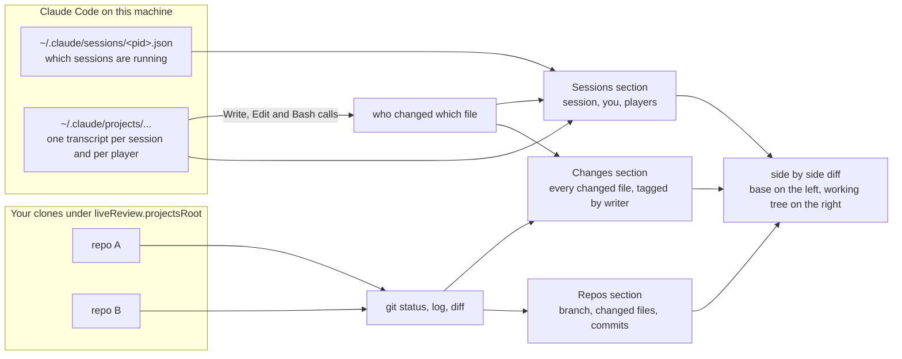

# Live Review

Live Review is a VS Code panel that shows every Claude Code session running on your machine, each agent (player) inside it, the files each one changed, and a diff per file, next to the git repos you choose to watch. You want it when one or more Claude Code sessions are editing several repos at once and you need to review what each agent is doing while it works, without switching branches or running git by hand.

It only reads: the session transcripts Claude Code already writes and your local clones. It sends nothing anywhere and never writes to a repo.


*One Claude Code session working in `demo/shop`: the repo is ticked in Repos and compared to `origin/main`, Sessions shows who changed which file, and clicking `hero.tsx` in Changes opened its diff.*

## How it fits together



A session is one `claude` process you started in a terminal. A player is an agent that session started (a subagent); the session's own agent is listed as "you". Every file a player wrote is matched to the repo it sits in, and every file opens a diff against the base of its repo: HEAD by default, or the branch you pick with [Compare to a branch](#compare-to-a-branch).

## Requirements

| What | Why | Check it |
|---|---|---|
| Linux, or Windows with WSL (VS Code connected to the WSL side) | A session counts as running while its process is alive, and that is read from `/proc/<pid>/stat`. macOS and plain Windows have no `/proc`, so the Sessions section stays empty there (Repos and Changes still work). | `ls /proc/self/stat` prints the path. |
| VS Code 1.100 or newer | The extension declares `^1.100.0` as the VS Code version it runs on; an older VS Code refuses the install. | `code --version`: the first line is 1.100.0 or higher. |
| git on the `PATH` of the machine the extension runs on | Every repo fact comes from git. Without it every repo sits under **Other** with `no commits, 0 changed`. | `git --version` prints a version. |
| Claude Code, on the same machine and user as VS Code's extension host | Only for Sessions and the file credits in Changes: they come from the files Claude Code writes under `~/.claude`. Repos and Changes work without it. | `claude --version` prints a version, and with a `claude` open in a terminal, `ls ~/.claude/sessions` lists a `<pid>.json` for it. |
| Node.js 22 or newer | Only to build from source or to run the probe script (`@vscode/vsce` 4 needs Node.js 22). | `node --version` prints v22 or higher. |

## Install

### From a GitHub release

1. Download `live-review-0.3.0.vsix` from the [releases page](https://github.com/v1siond/live-review/releases).
2. Install it from a terminal:

   ```bash
   code --install-extension live-review-0.3.0.vsix
   ```

   Or from VS Code: open the Extensions view (`Ctrl+Shift+X`), click the `...` menu at the top of the view, choose **Install from VSIX...** and pick the file.
3. Run **Developer: Reload Window** from the Command Palette (`Ctrl+Shift+P`).

Where to run that command depends on your setup: see [Your environment](#your-environment) below.

### From source

```bash
git clone https://github.com/v1siond/live-review.git
cd live-review
npm ci
npm run compile
npx @vscode/vsce package
code --install-extension live-review-0.3.0.vsix --force
```

Then reload the window.

### Your environment

Live Review runs in VS Code's extension host on the side that holds your workspace (with Remote WSL, that is the WSL distro). Three things must sit on that same side, under the same user: the extension, your git clones, and the `~/.claude` folder Claude Code writes, which means `claude` runs there too.

#### Linux

1. Install with `code --install-extension live-review-0.3.0.vsix` in your normal terminal.
2. Run `claude` as the same user that runs VS Code. Its sessions land in that user's `~/.claude`.
3. Keep your clones under `~/projects`, or set [`liveReview.projectsRoot`](#settings) to where they are.

#### Windows with WSL

1. Install the WSL extension in VS Code, open a WSL terminal, `cd` into your projects folder and run `code .`. The status bar's left corner reads `WSL: <distro>`.
2. Install Live Review from that WSL terminal with `code --install-extension live-review-0.3.0.vsix`, or with **Install from VSIX...** while connected. The Extensions view lists it under **WSL: &lt;distro&gt; - Installed**.
3. Run `claude` inside the same WSL distro. Its sessions land in your WSL user's `~/.claude`. A `claude` started from PowerShell or cmd writes to `C:\Users\<you>\.claude`, which the extension never reads.
4. Keep your clones inside the WSL file system (`~/projects` by default).

#### macOS

Install it the same way as on Linux (run **Shell Command: Install 'code' command in PATH** from the Command Palette first if `code` is not found in your terminal). Repos, Changes and the diffs work. Sessions is not supported: a session counts as running only when its `/proc/<pid>/stat` is readable, and macOS has no `/proc`, so Sessions stays empty and files in Changes are tagged `by hand`.

#### Windows without WSL

Install it from VS Code with **Install from VSIX...**, and have git for Windows on the `PATH`. Repos, Changes and the diffs work. Sessions is not supported, for the same reason as macOS: there is no `/proc`. Set `liveReview.projectsRoot` with forward slashes after the `~` (`~/projects`) or as a full path (`C:/Users/<you>/projects`); a `~` followed by a backslash is not read as your home folder.

## First run

The [screenshot at the top](#live-review) is what these steps end with.

1. Click the Live Review icon in the left bar (a branch with three dots). The panel opens with three sections: Repos, Sessions and Changes. Repos lists your clones under their git system (`github.com 1 repos`, then each repo with an empty checkbox); Sessions and Changes are empty until a session runs and a repo is ticked.
2. If your clones live somewhere other than `~/projects`, open Settings (`Ctrl+,`), search for `liveReview.projectsRoot` and set your folder. The Repos section rescans right away.
3. In Repos, tick the checkbox of each repo you want to watch. Ticked repos are read every 4 seconds while the panel is visible, and they appear in Changes with every changed file.
4. Start `claude` in a terminal and give it work. Within 30 seconds the session shows in Sessions, with "you" and each player it starts, and under each one the files it changed.
5. To review a feature branch against `main`, hover the repo in Repos, click the compare icon (`git-compare`, the first of its three icons), type `origin/main` (or `main`) and press `Enter`. The repo's summary now starts with `vs origin/main`, for example `vs origin/main, feature/hero-banner, 3 changed, 1 ahead, 0 behind`.
6. Click any file in Repos, Sessions or Changes. Its diff opens side by side, titled `<file> (origin/main vs working tree)` in compare mode.

### Check it works

1. In a terminal on the side where the extension runs, `code --list-extensions --show-versions | grep live-review` prints `v1siond.live-review@0.3.0`.
2. Repos shows at least one git system with `N repos` and N above 0. A lone `github.com 0 repos` means `liveReview.projectsRoot` points at the wrong folder.
3. With a `claude` open in a terminal, `ls ~/.claude/sessions` lists a `<pid>.json` file, and Sessions lists that session within 30 seconds.
4. **View > Output**, pick **Live Review** in the list on the right: no line holds `failed:`. Each problem the extension hits while reading sessions or repos is logged there, and so is each `git fetch` that fails.

If a step does not show what it says, find the row in [Troubleshooting](#troubleshooting).

## The three sections

Each section has a Collapse All button in its title bar that folds only that section. Every list keeps what you expanded across refreshes.

### Repos

Every git clone found under `liveReview.projectsRoot` (up to `liveReview.scanDepth` folders deep), grouped by the git system its `origin` points at. The systems are read from the `Host` and `HostName` lines of `~/.ssh/config`: every alias whose host is github.com, a gitlab host or bitbucket.org, plus github.com. A clone that matches none sits under **Other**.

| Item | Icon | What it shows |
|---|---|---|
| A git system | `server` | Its alias from `~/.ssh/config` and "N repos". |
| A repo | `account` when a player of a listed session changed a file in it, `repo` otherwise; greyed when it has nothing to review | Its path relative to `liveReview.projectsRoot`, a checkbox, the players that changed it, then the summary (below). Hover for the full path and the origin URL. |
| A changed file | The file type's icon | The file name, its folder and its git status (`M` modified, `A` added, `D` deleted, `R` renamed, `??` untracked). Click for the diff. |
| A commit | `git-commit` | The subject, the short sha, the date and "not pushed" (or "ahead of &lt;branch&gt;" in compare mode). Expand it for its files, each with status "committed". |

The summary of a repo reads:

- `main, 3 changed, 2 unpushed, 1 behind`: the branch, the files changed now, the commits not pushed and, when there are any, the commits on the upstream you have not pulled.
- `vs origin/main, feature-x, 12 changed, 4 ahead, 7 behind`: in compare mode, the compare branch, the current branch, the files that differ from the merge base (committed or not), and the commits ahead of and behind the compare branch.
- `vs old-branch (missing), main, 3 changed, 2 unpushed`: you picked a branch that has no merge base with HEAD, so the repo falls back to the HEAD comparison.

Repos sort inside their system: repos a player edited first, then pinned ones, then repos with work to review, then the rest.

| Button | Where | What it does |
|---|---|---|
| `+` (`add`) | Section title bar | Adds a folder the scan missed. |
| Cloud (`cloud-download`) | Section title bar | Runs `git fetch` in every ticked repo, then refreshes. |
| Refresh (`refresh`) | Section title bar | Rescans the projects folder and reads every repo again. |
| Compare (`git-compare`) | On a repo, on hover | Opens the Compare to a branch pick for that repo. |
| Pin (`pin`) / Unpin (`pinned`) | On a repo, on hover | Keeps the repo at the top of its system, or lets it sort normally again. |
| `x` (`close`) | On a repo, on hover | Takes the repo off the list (and off the ticks). `+` brings it back. |

### Sessions

One node per Claude Code session running now, in any folder, newest first, named by its folder relative to `liveReview.projectsRoot` and its start time ("shop/api, 09:31"; an older session also shows its day).

| Item | Icon | What it shows |
|---|---|---|
| A session | `comment-discussion` | "N players, M working". Hover for its id and start time. |
| "you" and each player | Green spinning `sync` while working, yellow `watch` while waiting, grey `pass` when done | Its description (or its row and job, see [Rows and jobs](#rows-and-jobs-optional)), its state and its last action ("editing api.ts", "running the tests"). Click it to open its timeline: every tool call with its time. |
| A repo under a player | `repo`, or `folder` for "outside git" | The repos the player changed files in, with "N files". |
| A file under a player | The file type's icon | Its folder, its status (`uncommitted`, `unpushed`, `clean` or `outside git`) and "also written by another player" when it is shared. Click for the diff: a file the player changed with Edit that another player also wrote shows only this player's own edits. |
| Workspace files | `notebook` | Every file saved under `liveReview.workspaceRoot` since the session started, newest first. Listed on every session; it reads `0 files since the session started` while the setting is empty. |

The states:

- **working**: the transcript grew in the last 10 minutes and its last message is a tool call.
- **waiting**: the transcript has been quiet for 10 minutes in the middle of a tool call (a long background job, or a crash).
- **done**: its last message is a final text with no tool call after it. A finished player stays listed, greyed.

| Button | Where | What it does |
|---|---|---|
| Clear finished (`clear-all`) | On a session, on hover | Removes the session's finished players. |
| `x` (`close`) | On a session, on hover | Removes the session and all its players. |
| `x` (`close`) | On a player, on hover | Removes that player. |

What you remove stays removed across reloads until that player edits a file again. A session whose process ended stays listed until you remove it or reload the window.

### Changes

Every changed file of the ticked repos, grouped by repo, with the same summary as Repos. Uncommitted files come first with their git status, then the files only a commit holds, with status "unpushed" (or "committed" in compare mode). Each file is tagged with every player that wrote it:

- `you, shop/api`: the agent of the session started in `shop/api`.
- `Row 12`: a player with a row (see [Rows and jobs](#rows-and-jobs-optional)).
- The player's description, for a player with no row.
- `by hand`: no transcript of a listed session wrote it.

The section refreshes within 5 seconds of a save.

## Compare to a branch

By default every repo is compared to HEAD: you see the files changed now and the commits not pushed yet. When you review a feature branch, you usually want everything the branch changed since it left `main`, committed or not. That is what Compare to a branch does, per repo.

### Pick a branch for one repo

1. In Repos, hover the repo and click the compare icon (`git-compare`).
2. The pick lists, in this order:
   - **HEAD (uncommitted and unpushed work)**
   - **Use the default (liveReview.defaultCompareBranch)**
   - your local branches
   - your remote branches (each remote's `HEAD` left out)
3. Pick a branch. The repo is read again at once and its summary starts with `vs <branch>`.

The pick is saved per repo and is the same in every VS Code window. Press `Escape` to leave the repo as it was.

### Set a default for every repo

Set `liveReview.defaultCompareBranch` (for example `origin/main`). It applies to every repo that has no pick of its own and where that branch exists. A repo without that branch keeps the HEAD comparison, so one setting is safe across repos that name their main branch differently.

### What the comparison shows

With compare branch `X`, the base is `git merge-base X HEAD`: the commit where your branch left `X`. Everything is measured from that base:

- **changed files**: every file that differs between the base and HEAD, plus every uncommitted file, each counted once.
- **commits**: the commits from the base to HEAD (the newest 100), shown as "ahead of X".
- **ahead and behind**: `git rev-list --left-right --count X...HEAD`, the commits only on your side and the commits only on `X`.
- **diffs**: every file, dirty ones included, opens with the base on the left and your working tree on the right; the title reads `<file> (X vs working tree)`. A file deleted since the base shows an empty right side.

An example. `main` moved on after `feature` left it:

```
main:     A---B---C---F
               \
feature:        D---E   (HEAD, plus one unsaved edit in notes.md)
```

Compared to `main`, the base is `B`. The repo shows the files changed in `D` and `E` plus `notes.md`, the commits `D` and `E` as ahead of main, and `2 ahead, 2 behind`. The changes of `C` and `F` never show up as yours, since they landed on `main` after you branched.

When `X` does not resolve, shares no history with HEAD, or the repo has no commits yet, there is no base: the repo shows the HEAD comparison and the summary starts with `vs X (missing)`.

### Go back to HEAD

Open the pick on the repo and choose **HEAD (uncommitted and unpushed work)**. The repo stays on HEAD even when a default branch is set.

### Go back to the default

Open the pick on the repo and choose **Use the default (liveReview.defaultCompareBranch)**. The repo's own pick is dropped and the setting applies again (or HEAD, when the setting is empty or the branch is not in that repo).

## Settings

Open Settings (`Ctrl+,`) and search for `liveReview`, or edit `settings.json`. Every change applies at once.

| Setting | Type | Default | What it does | Example |
|---|---|---|---|---|
| `liveReview.projectsRoot` | string | `~/projects` | The folder scanned for git clones. A leading `~` is your home folder. Sessions are named relative to it, and a Bash call of a player only adds repos inside it. | `"~/code"` |
| `liveReview.scanDepth` | number | `3` | How many folder levels under `projectsRoot` are searched for a `.git` folder. `3` finds `projects/group/repo`. A higher number finds deeper clones and takes longer on a big tree. | `4` |
| `liveReview.workspaceRoot` | string | `""` | Optional. A folder outside every repo that holds one notes folder per project. When set, each session lists its Workspace files, and players get their row and job from the `ORCHESTRA.md` files there. Empty turns both off. | `"~/notes"` |
| `liveReview.defaultCompareBranch` | string | `""` | The branch every repo is compared to unless you picked something else for it. Used only in repos where the branch exists. Empty compares every repo to HEAD. | `"origin/main"` |

## Commands

The buttons call these commands. Only the first three are also in the Command Palette; the rest need the item they act on.

| Command | Title | Where |
|---|---|---|
| `liveReview.refresh` | Refresh | Repos title bar, Command Palette |
| `liveReview.fetch` | Fetch picked repos | Repos title bar, Command Palette |
| `liveReview.addRepo` | Add a repo folder | Repos title bar, Command Palette |
| `liveReview.compareTo` | Compare to a branch | On a repo in Repos |
| `liveReview.pinRepo` | Pin to the top of its system | On an unpinned repo in Repos |
| `liveReview.unpinRepo` | Unpin | On a pinned repo in Repos |
| `liveReview.removeRepo` | Remove from the list | On a repo in Repos |
| `liveReview.clearFinished` | Clear finished players | On a session in Sessions |
| `liveReview.removeSession` | Remove the session and its players | On a session in Sessions |
| `liveReview.removePlayer` | Remove the player | On a player in Sessions |
| `liveReview.openTimeline` | Open the player's timeline | Click on a player |
| `liveReview.openDiff` | Open the diff | Click on a file |

## Rows and jobs (optional)

If you keep a ticket table for your agents, the Sessions section can label each player with its ticket. It needs two things:

1. `liveReview.workspaceRoot` points at a folder with one notes folder per project, and the session writes (Write or Edit) at least one file in a project folder there. That folder's `ORCHESTRA.md` is the ticket table.
2. The player's description (the one Claude Code shows for the subagent) contains `Row <n>`, any case.

The row is the first line of `ORCHESTRA.md` shaped `| <status> | <n> | <ticket> |`, so a ticket table placed above other tables wins. For example:

```markdown
| status | # | ticket |
|---|---|---|
| building | 12 | Login page remembers the last email |
```

A player described as "Row 12 frontend player" is listed as `Row 12: Login page remembers the last email, frontend player` and tagged `Row 12` in Changes. Without the setting or the table, players keep their own description and everything else works the same.

## How attribution works

The running sessions come from Claude Code's registry, `~/.claude/sessions/<pid>.json`. An entry counts while its process runs with the start time the entry recorded, and only for terminal sessions (`kind` interactive, `entrypoint` cli): headless `claude -p` runs and background jobs are left out. A session's transcript is `~/.claude/projects/<folder>/<session>.jsonl`, and a player's is `~/.claude/projects/<folder>/<session>/subagents/agent-<id>.jsonl`. Both are read in 8 MB steps, then only from where the last read stopped.

- A Write, Edit or MultiEdit call names its file, so that file is the player's.
- A Bash call gets the changed files of the repos it runs in (its folder, a leading `cd`, and any `cd` or absolute path inside `liveReview.projectsRoot`). It keeps the ones its command names whose last save falls inside the call (from the call to its result, with 1 second of slack each side). A file the call only read keeps its old save time, so it is left out.
- A commit made inside a Bash call whose command carries the commit's subject gives the player every file of that commit.
- While the panel runs it remembers every credit it saw, so a file stays with the player that wrote it after someone else saves it again.
- A changed file is one that is dirty now, or inside an unpushed commit (in compare mode: different from the merge base).

## Privacy

- Git runs only read commands (`status`, `log`, `diff`, `show`, `rev-parse`, `rev-list`, `merge-base`, `for-each-ref`, `branch --show-current`, `remote get-url`), plus `git fetch` when you click Fetch and every 10 minutes for the ticked repos.
- Every git call passes `--no-optional-locks`, so it never takes the index lock while an agent commits in the same repo, and `GIT_TERMINAL_PROMPT=0`, so a fetch that needs a password fails instead of waiting.
- Every git call also passes `-c core.fsmonitor=false -c diff.external= -c core.hooksPath=/dev/null`, and the diff passes `--no-ext-diff`, so a repo's own `.git/config` cannot make the panel run a command when it reads that repo. A fetch still uses the repo's `core.sshCommand` and your ssh config, so tick only repos whose config you trust.
- From `~/.ssh/config` it reads only the `Host` and `HostName` lines. Keys are never opened.
- It reads `~/.claude/sessions`, `~/.claude/projects`, `/proc/<pid>/stat` and, when set, `liveReview.workspaceRoot`.
- It sends nothing anywhere: no telemetry, no network call besides `git fetch`.

## Troubleshooting

| Problem | Cause | Fix |
|---|---|---|
| No sessions on macOS or Windows | Liveness is read from `/proc/<pid>/stat`, which only Linux has. | Run Claude Code and VS Code inside WSL on Windows. On macOS the Repos and Changes sections work; Sessions stays empty. |
| No sessions listed on Linux or WSL | The session is headless (`claude -p`, the SDK) or a background job, or it started less than 30 seconds ago, or VS Code runs on a different machine, WSL distro or user than Claude Code. | Start `claude` in a terminal on the same side as VS Code and wait 30 seconds. In that same terminal, `ls ~/.claude/sessions` must list a `<pid>.json`; an empty or missing folder means `claude` runs under another home folder. Look in **View > Output > Live Review** for errors. |
| Sessions empty over Remote SSH | The extension runs on the remote host, so it reads the remote's `~/.claude` and `/proc`. A `claude` running on your own computer is never seen. | Install it while connected (**Install in SSH: &lt;host&gt;** in the Extensions view), run `claude` in a terminal on the remote host (VS Code's terminal already is), and use a Linux remote. |
| Sessions empty in a dev container | The extension runs inside the container, which reads the container's `~/.claude` and sees only the container's processes. A `claude` running on the host is never seen. | Install it in the container (**Install in Dev Container** in the Extensions view), run `claude` in a terminal inside the container, and have git in the container image. |
| Every repo sits under **Other** and reads `no commits, 0 changed, 0 unpushed` | git is not on the `PATH` of the extension host, so no git call works. | Install git on the side where the extension runs, check `git --version` there, and run **Developer: Reload Window**. |
| Repos shows only `github.com 0 repos` | `liveReview.projectsRoot` points at a folder that does not exist or holds no clone within `liveReview.scanDepth` levels. On Windows, a `~` followed by a backslash is not read as your home folder. | Set `liveReview.projectsRoot` to the folder that holds your clones, as a full path or as `~/<folder>`. Repos rescans at once. |
| A repo is missing from Repos | It is outside `liveReview.projectsRoot`, deeper than `liveReview.scanDepth` (the default `3` finds `projects/group/repo`; `projects/a/b/repo` needs `4`), it is a worktree or submodule (a `.git` file instead of a folder), or you removed it with `x`. | Change the setting, or click `+` in the Repos title bar and pick its folder. |
| A repo sits under **Other** | Its `origin` points at a host that is not github.com, a host named `gitlab.<something>` or bitbucket.org, and no `Host` alias in `~/.ssh/config` has one of those as its `HostName`; or the repo has no `origin` remote. | `git -C <repo> remote get-url origin` shows the URL. For an ssh alias, add `HostName gitlab.example.com` (your real host) under its `Host` line in `~/.ssh/config`; Repos rereads the file when it changes. A repo with no `origin`, or one on a host named otherwise, stays under Other and works the same. |
| A file is shown "by hand" | No transcript of a listed session wrote it: you saved it, a session you removed or that is no longer running did, or a Bash call wrote it without naming it in its command. | Expected for your own edits. For an agent's file, check the agent's session is listed in Sessions. |
| The diff shows the wrong base | The repo has a compare pick or a default branch you did not expect, or a dirty file in the HEAD comparison is compared to HEAD (only committed files use the upstream). | Read the repo's summary: `vs <branch>` names the base. Use the compare icon to pick HEAD or another branch. |
| Installed on Remote WSL but nothing shows | The VSIX went into the Windows side of VS Code. | Connect VS Code to WSL, then install from the WSL terminal (`code --install-extension live-review-0.3.0.vsix`) or with **Install from VSIX...** while connected, and reload the window. |
| Picks gone after upgrading to 0.3.0 | 0.3.0 has a new publisher, so VS Code sees a new extension with empty saved state. | Tick your repos again, pin them again, and uninstall the 0.2.x Live Review from the Extensions view (`code --list-extensions \| grep live-review` shows both ids). |

## Development

```bash
npm ci              # install the exact dependency tree
npm run compile     # TypeScript to out/
npm run watch       # recompile on every save
npx @vscode/vsce package   # writes live-review-<version>.vsix
```

The code is split in two: `src/core` reads sessions, transcripts and git with no VS Code dependency, and `src/view` holds the panel. The probe runs the core from a terminal, after `npm run compile`:

```bash
node scripts/probe.mjs                          # every running session, its players and their files
node scripts/probe.mjs <sessionId>              # one session
node scripts/probe.mjs --projects-root ~/code --scan-depth 4
node scripts/probe.mjs --repo ~/projects/shop   # one repo: the summary, then each changed path
node scripts/probe.mjs --repo ~/projects/shop --compare origin/main
```

With `--repo`, line 1 is the summary as Repos shows it and every next line is one changed path, sorted and unique, so you can compare it with git:

```bash
diff <(node scripts/probe.mjs --repo "$R" | tail -n +2) \
  <({ git -C "$R" status --porcelain=v1 -uall | cut -c4- | sed 's/.* -> //'; \
      git -C "$R" log -n100 --format= --name-only @{u}..HEAD; } | sed '/^$/d' | sort -u)
```

## License

[MIT](LICENSE)
